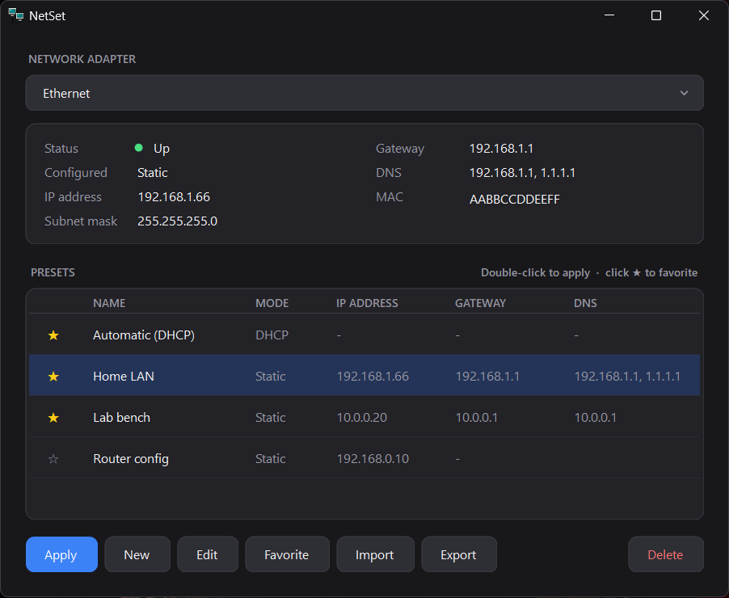
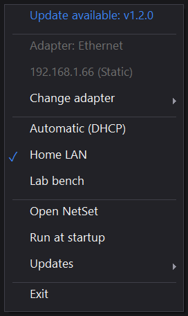
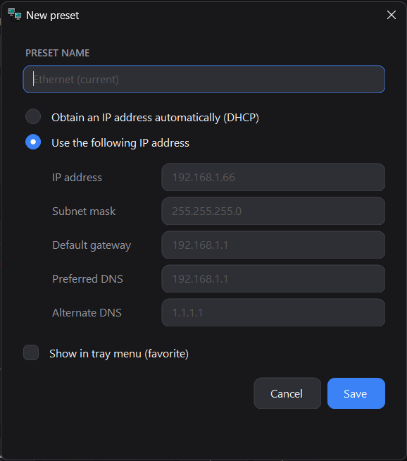

# NetSet

Switch a Windows network adapter between saved IP presets from the system tray.

Pick an adapter, save the IP settings you use (home, lab bench, a device's default address...), and flip between them in two clicks. Favorite presets live in the tray icon's right-click menu.

<p align="center">
  
</p>

<p align="center">
  
  &nbsp;&nbsp;
  
</p>

*The screenshots use sample presets (Home LAN, Lab bench, ...). The tray menu shows the adapter's current IP, a checkmark on the preset that matches it, and an update notice.*

## Download

Grab `NetSet.exe` from the [latest release](https://github.com/nickpetty/netset/releases/latest). It is a single self-contained file: no installer and no .NET runtime needed. Windows 10/11, x64.

NetSet changes adapter settings, which needs administrator rights, so it asks for elevation (a UAC prompt) when it starts. The exe is unsigned, so SmartScreen may warn the first time you run it.

## Features

- **Adapter picker** with live status, IP, mask, gateway, DNS and MAC.
- **Presets**: DHCP, or a static IP with mask, gateway and up to two DNS servers.
- **Favorites**: click the star on a preset and it appears in the tray menu. The favorite that matches the adapter's current settings gets a checkmark, re-checked every time the menu opens, so changes made elsewhere uncheck it.
- **Suggestions**: a new preset starts with the selected adapter's current settings as gray suggestions. Press **Tab** in an empty field to accept one, or just type to replace it.
- **Import / export** presets as JSON, with a merge-or-replace choice on import.
- **Run at startup** from the tray menu.
- **Update check** against GitHub releases (see below).
- Dark UI and a pre-2000 style "networked computers" tray icon, drawn in code.

## Using it

- Left-click the tray icon to open the window; right-click for the menu.
- The window opens by itself on the very first run. After that NetSet stays in the tray, and closing the window hides it again. Use **Exit** in the tray menu to quit.
- Double-click a preset (or select it and press **Apply**) to switch the selected adapter to it. Click a preset's star to toggle favorite.
- **Run at startup** creates a scheduled task named `NetSet` (at logon, highest privileges) instead of a registry Run key, because Windows skips elevated apps in Run keys. Startup launches stay in the tray and do not open the window. If you move the exe, toggle the option off and on again.

## Updates

NetSet checks the [GitHub releases](https://github.com/nickpetty/netset/releases) page a few seconds after launch and then once a day. When a newer version exists you get a notification and an **Update available** entry at the top of the tray menu; clicking either opens the release page in your browser. Nothing is downloaded or installed automatically.

The only network request is a read of the public releases API (`api.github.com`). Turn it off, or check on demand, under **Updates** in the tray menu.

## Build from source

Requires the .NET 8 SDK (or newer) on Windows.

```powershell
dotnet publish -c Release -o publish
```

This produces a single self-contained, trimmed `publish\NetSet.exe` (about 40 MB).

## Where things are stored

- Presets, the last-used adapter and update settings: `%AppData%\NetSet\settings.json`
- Adapter changes are applied with `netsh`.
- `NetSet.exe --show` opens the window at launch; `NetSet.exe --export-icon <file>` regenerates the `.ico` from the drawing code.

## Project layout

| File | Purpose |
| --- | --- |
| `Program.cs` | Entry point, single-instance guard |
| `TrayApp.cs` | Tray icon, context menu, applying presets, update notifications |
| `MainForm.cs` / `PresetEditor.cs` | Main window and preset editor |
| `Controls.cs` / `Theme.cs` | Custom dark controls and palette |
| `NetworkConfig.cs` | Reads adapter info, applies settings via `netsh` |
| `UpdateChecker.cs` | GitHub release check |
| `StartupTask.cs` | Run-at-startup scheduled task |
| `Preset.cs` | Preset model, settings store, import/export |
| `IconFactory.cs` | The pixel-art tray and app icon |

## License

[MIT](LICENSE)
